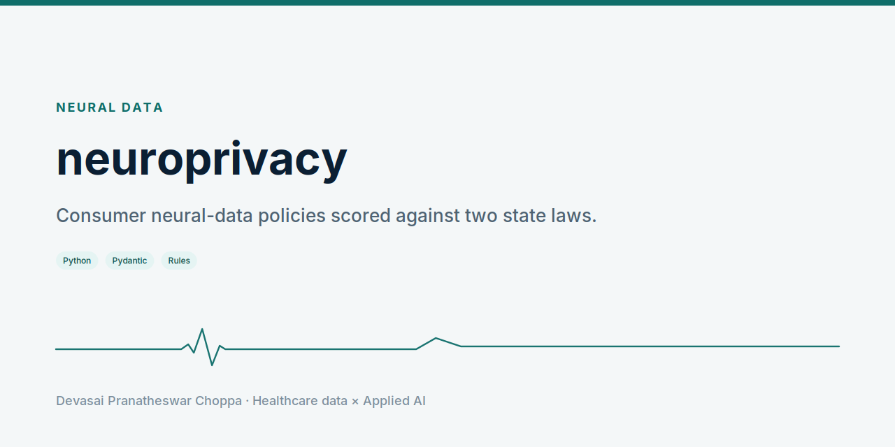
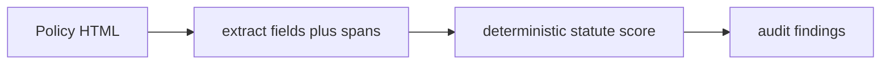

<picture>
  <source media="(prefers-color-scheme: dark)" srcset="docs/social-preview-dark.png">
  
</picture>

**Span-cited audit of consumer neural-data policies against Colorado HB24-1058 and California SB 1223.**

<p align="center">
  
</p>

Observations only. Not a legal conclusion, not legal advice, and not a compliance certification.

## Problem

Privacy policies for consumer neural devices are long, and the statutory duties are specific. A keyword search misses a generic device-data clause that still covers neural data.

## Solution

The extractor returns typed fields with character spans, from a committed cache on the sample policies. Deterministic rules score those fields against the encoded clauses. A network-capture path exists and is off by default.

## Architecture



Scoring lives in `src/neuroprivacy/scoring.py`. Statutes live in `src/neuroprivacy/statutes.py`.

## Tech stack

Python 3.11, Pydantic, Typer, Rich, DuckDB, pytest.

## Quickstart

```bash
make setup
make demo
```

One document:

```bash
neuroprivacy extract --doc data/sample/vendor-a.html
```

No credentials. The sample policies are committed fixtures.

## Results

From the committed evaluation table:

| System | Metric | n | Notes |
| --- | --- | --- | --- |
| Rules plus cache extractor | mean field F1 1.000 | 20 | Against hand labels |
| Keyword baseline | kappa 0.722 versus the extractor | 20 | Misses generic device-data cover |
| Statute coverage | policy-text 0.636 | 22 | Encoded clauses of the two statutes |
| Live public-policy hold-out | not run | — | Must beat the Phase 0 field F1 |

## Roadmap

The live hold-out is the open measurement. Sample-set F1 is not that measurement.

## License

MIT.
